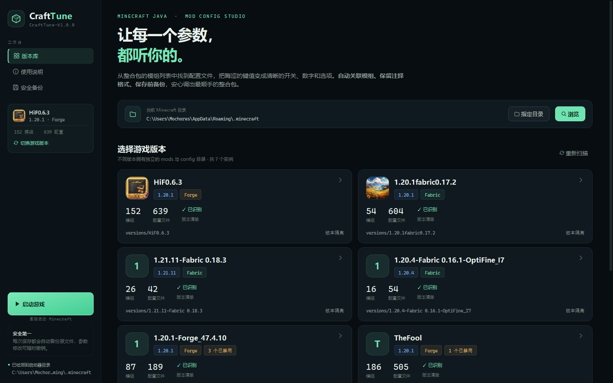
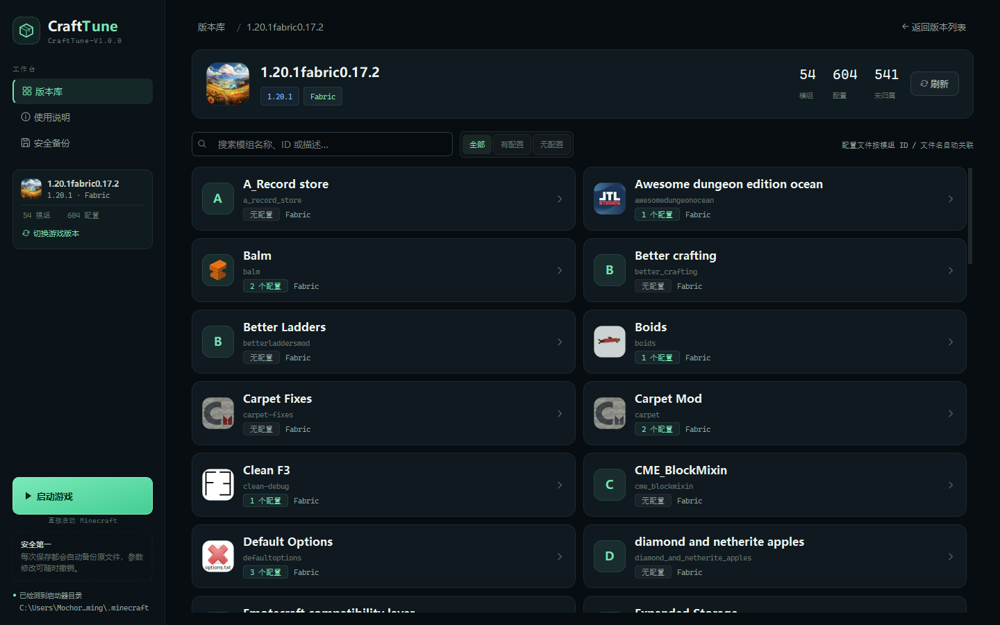
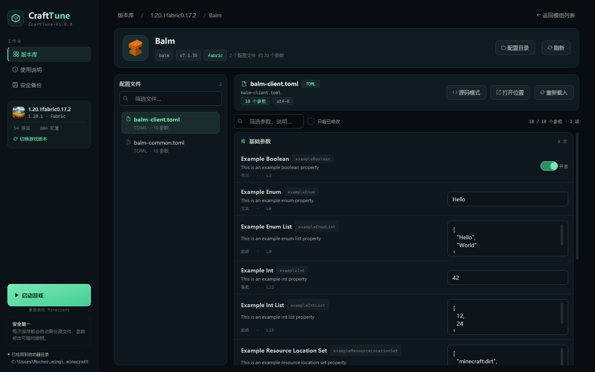
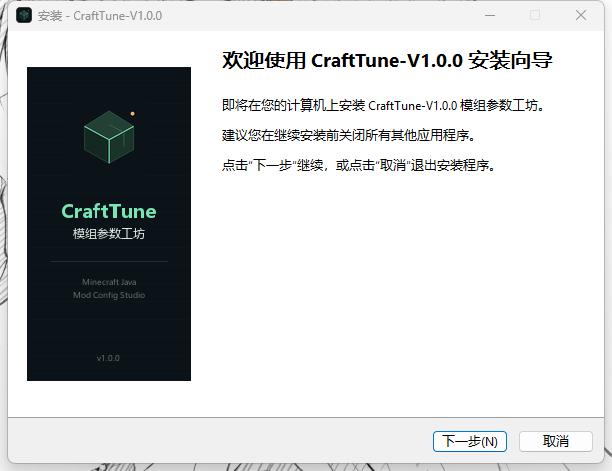

# CraftTune-V1.0.0 · 模组参数工坊

**CraftTune 的第一个大版本。**

面向 Minecraft Java 版整合包的**原生桌面**配置管理器。选择游戏版本 → 选择模组 → 修改参数，支持自动备份、注释保留和多种配置格式。

界面使用 PyQt5 构建，不依赖浏览器，也不会启动本地网页服务。

> **版本命名**：CraftTune-V1.0.0 是作品的第一个大版本，后续功能迭代将从这里继续。



## 功能

- **版本选择**：自动读取 `.minecraft/versions` 下的版本隔离实例，并识别 Fabric / Forge / NeoForge / Quilt / OptiFine 与游戏版本。
- **模组列表**：解析 JAR 内的 `fabric.mod.json`、`mods.toml`、`neoforge.mods.toml`、`quilt.mod.json`、`mcmod.info`，显示名称、ID、版本、图标、启用状态。
- **配置关联**：按模组 ID、JAR 文件名、配置目录名自动把 `config/` 中的文件归到模组；无法匹配的文件集中到“未归属配置文件”，仍可编辑。
- **参数可视化**：布尔值用开关、数字用数字框、字符串用文本框、枚举用下拉框、数组/对象用 JSON 编辑器。
- **安全保存**：只替换目标值，保留注释、缩进、换行和文件编码；保存前自动备份到 `data/backups`。
- **源码模式**：任何文本配置都可以切换到源码编辑；超大文件、SNBT、XML 等特殊格式会自动使用源码模式。
- **冲突保护**：如果文件在编辑期间被外部程序修改，会拒绝覆盖并提示重新载入。
- **一键启动**：左下角“启动游戏”按钮会直接调用 Java 启动 Minecraft，不经过 PCL 或其他启动器。自动读取版本清单、补全 Fabric 加载器、解压运行库并启动游戏；缺少客户端 JAR 时会自动下载并校验。
- **搜索与筛选**：按模组名称、ID、描述搜索；按“有配置 / 无配置”筛选；参数可按键名、说明筛选，只看已修改。
- **桌面原生**：PyQt5 窗口、键盘快捷键（`Ctrl+S` 保存、`Ctrl+F` 搜索、`Alt+←` 返回）、系统文件夹选择框；只在本机读写文件。





## 快速开始

### 方式一：安装包（推荐）

双击 **`installer_output/CraftTune-V1.0.0-Setup.exe`**：

- 默认安装到 `%LOCALAPPDATA%\Programs\CraftTune`，**不需要管理员权限**
- 自动创建开始菜单快捷方式，可选创建桌面快捷方式
- 支持从 Windows“设置 → 应用”中正常卸载
- 安装完成后可直接勾选运行 CraftTune



> 安装包没有购买代码签名证书，首次从网络下载后 Windows SmartScreen 可能提示“Windows 已保护你的电脑”。点击“更多信息 → 仍要运行”即可。
>
> 安装包 SHA256 校验值见 `installer_output/SHA256.txt`。
>
> 卸载时默认保留 `data/` 中的设置和备份，避免误删配置文件备份；需要彻底删除时手动删除安装目录。

### 方式二：直接运行 EXE

双击 `dist/CraftTune-V1.0.0.exe`。不需要安装 Python，也不需要浏览器。程序会在 EXE 旁边创建 `data/` 目录保存设置与备份。

### 方式三：双击启动源码

1. 确认已安装 **Python 3.8+**。
2. 双击 `启动 CraftTune.bat`。
3. 首次启动会自动安装 PyQt5 等依赖。
4. 在主窗口选择游戏版本 → 选择模组 → 修改参数 → 点击“保存到文件”。

关闭程序窗口即可退出。

### 方式四：命令行

```bash
pip install -r requirements.txt
python desktop.py
```

## 从源码打包

### 1. 打包 EXE

```powershell
pip install pyinstaller
pyinstaller --noconfirm --onefile --windowed --name CraftTune `
  --icon assets/app.ico --version-file assets/version_info.txt `
  --add-data "assets;assets" `
  --collect-submodules minecraft_launcher_lib `
  --hidden-import=pkg_resources.py2_warn `
  desktop.py
```

生成的 `dist/CraftTune.exe` 重命名为 `dist/CraftTune-V1.0.0.exe`：

```powershell
Move-Item dist\CraftTune.exe dist\CraftTune-V1.0.0.exe -Force
```

该文件可以复制到任意目录运行，`data/` 会创建在 EXE 旁边。

### 2. 打包安装程序

安装 [Inno Setup 6](https://jrsoftware.org/isinfo.php)，然后执行：

```powershell
& "$env:LOCALAPPDATA\Programs\Inno Setup 6\ISCC.exe" installer\CraftTune.iss
```

生成的安装包位于 `installer_output/CraftTune-V1.0.0-Setup.exe`。安装脚本在 `installer/CraftTune.iss`，包含中文安装向导、开始菜单/桌面快捷方式、卸载入口和版本信息。

## 一键启动游戏

左下角的绿色“启动游戏”按钮位于“安全第一”提示上方。它不会调用 PCL，而是由 CraftTune 自己生成 Java 启动命令：

1. 读取所选版本的版本清单，自动选择 Java 17 / 21 运行时。
2. 解压 LWJGL 等运行库到 `versions/<版本>/natives`。
3. 补全 Fabric 加载器（针对缺少加载器清单的旧 Fabric 整合包）。
4. 如果版本目录缺少客户端 JAR，会从 Mojang 官方地址下载到 `data/cache/clients` 并做 SHA1 校验。
5. 使用本机保存的 Minecraft 账号档案启动；如果令牌已过期，则以离线账号启动，单人游戏可正常进入。
6. 游戏日志写入 `versions/<版本>/logs/crafttune-direct.log`。

> 如果所选版本缺少版本清单（例如某些只保留了 mods/config 的整合包），按钮会置灰并提示无法直接启动。
>
> 离线启动只影响正版服务器登录；单人游戏和大部分整合包功能不受影响。需要正版服务器联机时，请先让本机启动器重新登录一次账号。

## 支持的配置格式

| 格式 | 结构化编辑 | 说明 |
| --- | --- | --- |
| `.toml` | ✅ | Forge / NeoForge / Fabric 模组配置，保留 `[...]` 表与注释 |
| `.json` / `.json5` / `.jsonc` / `.hjson` | ✅ | 支持注释、尾随逗号、未加引号的键 |
| `.yaml` / `.yml` | ✅ | 支持嵌套映射与标量 |
| `.properties` / `.conf` / `.ini` | ✅ | `key=value`、`key:value` |
| `.cfg` | ✅ | Forge 旧式 `B:` / `I:` / `D:` 类型前缀 |
| `.txt` | ✅ / 源码 | 自动识别 TOML 风或 `key:value` 风；其他文本用源码模式 |
| `.snbt` / `.xml` 等 | 源码 | 保留原格式，直接编辑 |

Forge 配置中偶尔出现未加引号的资源位置（例如 `[minecraft:dirt]`），CraftTune 会用宽松解析读取；保存时会写成合法的引号形式，Forge 可以正常读取。

## 目录结构

```text
project03（mod配置器）/
├─ desktop.py                 原生桌面入口
├─ ui/
│  ├─ main_window.py          窗口、导航、异步加载、保存流程
│  ├─ pages.py                版本页 / 模组页 / 参数编辑页
│  ├─ widgets.py              卡片、开关、参数行、忙碌遮罩
│  ├─ theme.py                QSS 主题与 SVG 图标
│  └─ async_utils.py          后台线程桥接
├─ backend/                   复用原有扫描、解析、备份核心
│  ├─ discovery.py
│  ├─ modmeta.py
│  ├─ parsers.py
│  ├─ service.py
│  ├─ direct_launcher.py     直接构建 Java 命令启动 Minecraft
│  ├─ settings.py
│  └─ util.py
├─ assets/                    应用图标、版本信息
├─ docs/                      界面与安装向导截图
├─ installer/
│  ├─ CraftTune.iss           Inno Setup 安装脚本
│  ├─ ChineseSimplified.isl   中文安装界面
│  ├─ wizard.bmp              安装向导配图
│  └─ wizard-small.bmp
├─ tests/test_backend.py      解析器与保存流程测试
├─ dist/CraftTune-V1.0.0.exe         已打包桌面程序
├─ RELEASE_NOTES-V1.0.0.md           第一个大版本发布说明
├─ installer_output/
│  ├─ CraftTune-V1.0.0-Setup.exe     已打包安装程序
│  └─ SHA256.txt
├─ requirements.txt           桌面版依赖
├─ requirements-web.txt       可选旧网页服务端依赖
├─ 启动 CraftTune.bat
└─ README.md
```

> `web_server_legacy.py` 和 `web/` 是早期网页界面源码，仅作存档，不参与桌面版构建；桌面 EXE 不包含 Flask，也不会打开浏览器。

## 使用说明

1. **版本隔离**：CraftTune 优先读取 `versions/<版本名>/mods` 和 `versions/<版本名>/config`。如果整合包没有使用版本隔离，会把配置目录显示为共享目录。
2. **模组关联**：关联是启发式的，依据模组 ID、JAR 文件名和配置目录。找不到归属的配置会显示在“未归属配置文件”里。
3. **保存机制**：点击保存时，只将修改过的值写回文件；不会重排整个文件。原文件会备份到 `data/backups/<时间>/<版本>/<相对路径>`。
4. **修改时机**：建议关闭游戏后再修改。部分模组只在启动时读取配置，修改后需要重启游戏。
5. **编码**：优先 UTF-8、GBK，无法识别时使用 Latin-1 兜底，尽量保证原字节不被破坏。
6. **超大文件**：超过约 1.5 MB 的配置文件会跳过结构化解析，自动进入源码模式，避免界面卡顿。

## 测试

```bash
set PYTHONPATH=.
python -m unittest tests.test_backend -v
```

## 常见问题

**没有找到游戏版本？**
确认选择的是包含 `versions`、`mods` 或 `config` 的 `.minecraft` 目录，而不是单个模组或资源包目录。

**模组没有配置文件？**
有些模组把参数存在世界存档的 `serverconfig` 中，或完全不提供配置文件；部分模组只在游戏内 GUI 修改。

**配置文件里的中文显示为乱码？**
该文件可能是混合编码或非标准编码。CraftTune 会用 Latin-1 兜底并保持字节不变；源码模式下仍可编辑。

**保存后游戏报配置错误？**
在“安全备份”中打开最新备份，退出 CraftTune 后用备份覆盖原文件即可回滚。

## 技术说明

- 桌面 UI：Python 3.8 + PyQt5 5.15
- 启动器：minecraft-launcher-lib 生成参数 + 原生 Java 进程直接启动
- 后端：复用原有扫描 / TOML / JSON5 / YAML / Properties / CFG 解析与备份逻辑
- 数据目录：`data/settings.json`、`data/backups/`、`data/cache/`
- 所有文件读写都在本机完成
